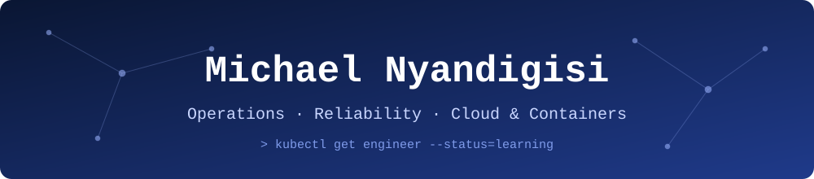

\<p align="center"\>
  \
\</p\>

\<p align="center"\>
  \<a href="https://michaelnyandigisi.github.io"\>\\</a\>
  \<a href="https://www.linkedin.com/in/michaelnyandigisi/"\>\\</a\>
  \
\</p\>

## 👋 About me

Senior Operations Engineer with 4+ years across production operations, enterprise IT and regulated financial services. I keep a production FinTech platform healthy day to day: monitoring, health checks, failure investigation, recovery and routine database maintenance. I'm building towards a career in **Site Reliability Engineering**, with a focus on **cloud and containers** (Docker, Kubernetes).

```yaml
name:      Michael Nyandigisi
location:  Nairobi, Kenya 🇰🇪
role:      Senior Operations Engineer (SRE-focused)
focus:     [monitoring, incident response, automation, cloud & containers]
learning:  [Kubernetes, Azure (AZ-204), Python]
open_to:   SRE & platform engineering roles
off_duty:  Arsenal fan ⚽
```

## 🔭 What I'm up to

- 📈 Monitoring and health-checking a production KYC/AML platform for a regulated FinTech
- 🛠️ Recovery procedures, database clear-downs and maintenance, ticket-driven incident handling
- 🤖 Automating reporting with Python and shell scripting
- 🐳 Running workloads in Docker, and levelling up in Kubernetes
- ☁️ Studying for Microsoft Azure Developer Associate (AZ-204)

## 🚀 Projects

| Project | What it is | Stack | Link |
|---|---|---|---|
| ⏱️ **Network Telemetry Pipeline** | Automated network performance monitoring platform deployed on Azure. Collects speed, latency and jitter metrics every 10 minutes, stores results in PostgreSQL, visualizes them in Grafana, and automates builds and deployment through Jenkins CI/CD. | Python · Azure · Docker · Jenkins · PostgreSQL · Grafana · Linux | [Code](https://github.com/michaelnyandigisi/net-telemetry-pipeline) |
| 🌐 **Portfolio** | My personal portfolio site | HTML · CSS · JS | [Live](https://michaelnyandigisi.github.io/) · [Code](https://github.com/michaelnyandigisi/michaelnyandigisi.github.io) |
| 🤖 **ai-ats-scanner** | AI-powered ATS scanner and resume matcher | Python | [Code](https://github.com/michaelnyandigisi/ai-ats-scanner) |
| 🏧 **simple_atm** | Console ATM program | Python | [Code](https://github.com/michaelnyandigisi/simple_atm) |
| 📦 **console_shipping_calculator** | Calculates shipping cost from weight and method | Python | [Code](https://github.com/michaelnyandigisi/console_shipping_calculator) |
| 🧮 **simple-python-calculator** | Simple console calculator | Python | [Code](https://github.com/michaelnyandigisi/simple-python-calculator) |

More infrastructure and automation projects are in development.

## 🛠️ Tech stack

**Containers & cloud**


**Operations & monitoring**


**Data**


**Automation & CI/CD**


## 📜 Certifications

| | Certification | Issuer | Status |
|---|---|---|---|
| ☁️ | Microsoft Azure Developer Associate (AZ-204) | Microsoft | In progress |
| ☁️ | Microsoft Azure Fundamentals (AZ-900) | Microsoft | In progress |
| 🛡️ | CompTIA Security+ | CompTIA | In progress |
| 🛠️ | ITIL 4 Foundation | Axelos | In progress |
| 🌐 | Google Cybersecurity Certificate | Google | 2026 |
| ⚔️ | Cisco Ethical Hacker | Cisco Networking Academy | 2024 |
| 🔍 | Cisco Cyber Threat Management | Cisco Networking Academy | 2024 |

**Education:** BSc Information Systems & Technology (Forensic IT & Cybersecurity), USIU-Africa

## 🤝 Let's connect

- 🌍 Portfolio: [michaelnyandigisi.github.io](https://michaelnyandigisi.github.io/)
- 💼 LinkedIn: [in/michaelnyandigisi](https://www.linkedin.com/in/michaelnyandigisi/)
- ✉️ Email: use the button on my portfolio

---

\<p align="center"\>\<sub\>COYG ⚽ · uptime 99.9%\</sub\>\</p\>
